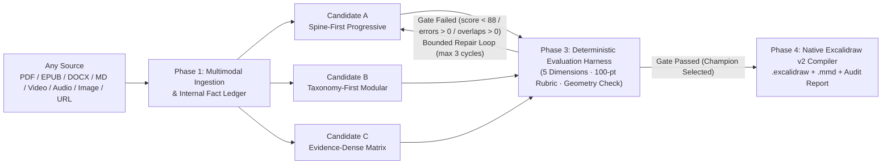

# Cartograph

**Autonomous Instructional Knowledge Graph & Excalidraw Synthesis Engine**

[](#quick-start)
[](#native-excalidraw-v2-compiler)
[](#deterministic-evaluation-harness)
[](#architecture)
[](#installation)
[](#license)

> Turn any book, paper, course, video, audio recording, image, or web page into a **fact-audited, zero-overlap, pedagogically structured Mermaid Flowchart (`.mmd`) and native editable Excalidraw (`.excalidraw`) canvas** — backed by multi-candidate tournament synthesis, a deterministic evaluation harness, and a bounded self-healing loop.

---

## Why Cartograph?

Most AI diagram generators and book-reading scripts fail in one of two ways:

1. **Page-by-page linear summarizers** slice arguments mechanically at arbitrary page boundaries, producing fragmented bullet lists that break narrative coherence and feel worse to read than the original text.
2. **Single-shot LLM Mermaid generators** hallucinate loose hairball graphs, break Mermaid syntax, clip CJK text, omit supporting evidence, or require browser DOM runtimes just to produce an Excalidraw file.

**Cartograph** applies **T0 agentic harness engineering** to visual knowledge architecture:
- It ingests **universal multimodal sources** without dropping formulas, parameters, edge cases, or citations.
- It generates **multiple competing architectural candidates** and runs them through a **deterministic 100-point evaluation harness** (syntax, relation discipline, AABB geometric overlap, subgraph containment, edge crossings, and typography density).
- It runs a **bounded self-healing critique-repair loop** until hard quality gates pass, then compiles the winning candidate offline into a ready-to-open **Excalidraw v2** whiteboard file.

---

## Architecture



---

## Engineering Comparison

| Capability | `excalidraw/mermaid-to-excalidraw` | Single-Shot LLM Prompt | Page-by-Page Book Reader | **Cartograph** |
|---|:---:|:---:|:---:|:---:|
| Universal multimodal ingestion (PDF/EPUB/DOCX/Media/URL) | — | Partial | Text/PDF only | **Full** |
| Semantic skeleton reconstruction (non-fragmented) | — | Partial | — | **Full** |
| In-module dashed evidence preservation + cross-module noise filtering | — | Unreliable | — | **Enforced** |
| Multi-candidate architecture tournament | — | — | — | **Built-in** |
| Deterministic 100-pt eval harness (syntax + geometry + crossings) | — | — | — | **Built-in** |
| Bounded self-healing critique-repair loop (`max=3`, stall guard) | — | — | — | **Built-in** |
| Offline `.excalidraw` v2 compilation (zero Node / browser DOM) | Browser DOM only | — | — | **Stdlib Python** |
| Built-in regression self-test suite (`--self-test`) | Unit tests | — | Unit tests | **16-test suite** |

---

## Key Engineering Pillars

### 1. Universal Multimodal Ingestion & Chinese-First Localization
| Source Type | Ingestion Path | Notes |
|---|---|---|
| **PDF, Images, Audio, Video** | Native multimodal agent reading | Preserves diagrams, equations, slides, and spoken nuance |
| **EPUB, DOCX, HTML, SRT/VTT, MD, TXT** | `scripts/extract_content.py` | Pure Python stdlib; DRM detection, heading preservation, subtitle timestamp cleanup |
| **Static & Dynamic Web URLs** | `extract_content.py` / Browser subagent | Strict factual boundary: inaccessible sources trigger `【资料缺口说明】`, never hallucinated |

- **Chinese-First Policy (Default `--lang zh`)**: Foreign-language sources (English books, papers, courses, videos) are translated and localized into natural, idiomatic Simplified Chinese before graph synthesis, preserving core terminology, acronyms, formulas, and tool names in concise bilingual parentheticals (e.g., `投资回报率（ROI）`, `反馈回路（Feedback Loop）`). `eval_harness.py` deterministically enforces `cjk_node_ratio >= 0.85` unless `--lang en` is explicitly requested.

### 2. Code-Enforced Multi-Candidate Tournament Synthesis
`scripts/orchestrate_pipeline.py` runs an automated `run_workflow` parallel pipeline that spawns **3 independent synthesis agents concurrently**:
- **Candidate A (`spine-first`)**: Maximizes horizontal causal/progressive chains inside each module while stacking secondary modules (`MOD_*`) cleanly top-to-bottom.
- **Candidate B (`taxonomy-first`)**: Maximizes vertical categorical clarity and minimal edge crossings.
- **Candidate C (`evidence-dense`)**: Isolates formulas, case studies, counterarguments, and risks into local labeled dashed auxiliary nodes right beside the claims they support.

All candidates compete head-to-head inside `scripts/eval_harness.py`; the highest-scoring compliant candidate enters the bounded repair loop and is exported as the winning optimal edition.

### 3. Deterministic Evaluation Harness
Every candidate is compiled to actual routed Excalidraw canvas coordinates and graded deterministically on a **100-point rubric**:

| Dimension | Weight | Automated Checks |
|---|---:|---|
| **Spec & Localization Compliance** | 30 | `flowchart LR`, unique non-reserved IDs, zero subgraph-endpoint edges, zero internal placeholder terms, full `class` coverage, edge budget `≤ 500`, and Chinese localization check (`cjk_node_ratio >= 0.85` in default `zh` mode) |
| **Structural & Relation Discipline** | 25 | `ROOT → all MOD`, explicit strong-logic chains, labeled auxiliary dashed lines, penalty on vague `"相关"` labels, cross-MOD ratio control |
| **Geometric Layout & Obstacle-Free Routing** | 20 | Exact AABB node-to-node overlap check (`== 0`), outer subgraph overlap check (`== 0`), 100% container containment, **routed arrow-through-node collision check (`== 0`)**, exact segment-crossing count, canvas aspect ratio |
| **Readability & Typography Density** | 15 | Node line count `≤ 6`, CJK-weighted line width `≤ 28` units, clean `<br/>` breaks, zero empty nodes |
| **Evidence & Auxiliary Fidelity** | 10 | Local dashed evidence/case/formula attachment and `key` conclusion visual differentiation |

**Hard Quality Gate**: `valid == True`, `lang_ok == True`, `node_overlaps == 0`, `subgraph_overlaps == 0`, `outside_container_nodes == 0`, `arrow_node_collisions == 0`, and `total_score >= 88.0`.

### 4. Bounded Self-Healing Loop
If the leading candidate misses the quality gate (or still has actionable repairs), `orchestrate_pipeline.py` feeds the structured `repairs` diagnostics from the harness JSON into a repair agent and re-evaluates — strictly bounded to **at most 3 repair iterations** with automatic rollback on non-improvement and stall detection (`delta < 1.0`).

### 5. Offline-Cached Official Excalidraw Engine + Zero-Interference Solver + Real-PNG Visual Self-Check
Cartograph exports final `.excalidraw` canvases through **Excalidraw's exact official engine** (`elbow: true`), resolves real-world geometric interferences deterministically, and renders real rasterized PNG close-ups via Excalidraw's own `exportToBlob` — with **zero Node.js, zero npm, and zero Playwright installs**:
- **Primary Engine (`scripts/official_excalidraw_export.py` & `.ps1`)**: Launches locally installed headless Chrome or Edge against `resources/official_converter.html`, runs the real `@excalidraw/mermaid-to-excalidraw@3.6.0` (`elbow: true`) + `@excalidraw/excalidraw@0.18.1` modules via a local `/npm/*` proxy with persistent disk cache (`resources/cdn_cache/`, 100% offline after first run), and produces 100% orthogonal elbowed `.excalidraw` v2 JSON.
- **Zero-Interference Deconfliction Gate (`scripts/excalidraw_deconflict.py`)**: Audits and fixes the ACTUAL exported `.excalidraw` JSON using Excalidraw's exact bound-label placement formula — adding CJK breathing padding, recentering wall-hugging elbow bends into open white channels, and minimally expanding narrow corridors until `label_vs_node_overlaps == 0`, `label_vs_label_overlaps == 0`, `node_text_overflows == 0`, `node_vs_node_overlaps == 0`, and `arrow_vs_node_collisions == 0` while preserving 100% orthogonal segments (`orthogonal_ratio == 1.0`).
- **Photographic Visual Self-Inspection (`--render-dir` / `-RenderDir`)**: Uses Excalidraw's official `exportToBlob` to render high-res close-up PNG tiles of the post-deconflict `.excalidraw` so agents inspect real rendered pixels before delivery.
- **Offline Fallback (`scripts/mermaid_to_excalidraw.py`)**: Pure Python stdlib layout/auditor used both inside the deterministic evaluation harness and as a browser-free fallback.

---

## Installation

Install as a global Agent Skill in your customization root:

```text
# Antigravity (auto-discovered globally)
~/.gemini/config/skills/knowledge-graph-architect/

# Cross-agent compatible path (Claude Code / Codex / Open Agent Skills)
~/.agents/skills/knowledge-graph-architect/
```

### Directory Layout

```text
knowledge-graph-architect/
├── SKILL.md                                  # Agent runbook & Phase Contracts
├── README.md                                 # Project documentation (this file)
├── resources/
│   └── official_converter.html               # Official @excalidraw ESM bridge for headless Chrome/Edge
├── references/
│   ├── architecture-spec.md                  # Full visual, logical & Mermaid engineering spec
│   ├── loop-and-tournament-protocol.md       # Harness rubric, repair loop & tournament policy
│   └── ingestion-guide.md                    # Multimodal ingestion & fact-boundary handbook
├── scripts/
│   ├── extract_content.py                    # Zero-dep EPUB/DOCX/HTML/SRT/VTT/URL extractor
│   ├── official_excalidraw_export.py         # Primary exporter: headless Chrome/Edge + official @excalidraw engine
│   ├── official_excalidraw_export.ps1        # Zero-Python Windows PowerShell official Excalidraw exporter
│   ├── mermaid_to_excalidraw.py              # Static auditor + geometry checker + offline fallback compiler
│   ├── eval_harness.py                       # 100-pt deterministic harness (w/ Chinese localization), tournament & 8-test self-test
│   └── orchestrate_pipeline.py               # Code-enforced parallel 3-candidate tournament + bounded repair loop workflow
└── examples/
    └── golden-reference.mmd                  # Reference compliant Mermaid fixture
```

---

## Quick Start

### 1. Verify the Harness (Regression Self-Test)
```bash
python scripts/eval_harness.py --self-test
```
Expected output: `all_passed: true` (`16/16` tests passing).

### 2. Extract Structured Text from EPUB / DOCX / Subtitles / URL
```bash
python scripts/extract_content.py path/to/book.epub -o extracted.txt
```

### 3. Run Multi-Candidate Tournament & Export via Official Excalidraw Engine
```bash
python scripts/eval_harness.py \
  --tournament candidate_a.mmd candidate_b.mmd candidate_c.mmd \
  --out-mmd output_graph.mmd

python scripts/official_excalidraw_export.py output_graph.mmd -o output_graph.excalidraw
```

### 4. Open the Output
Drag and drop `output_graph.excalidraw` directly onto [excalidraw.com](https://excalidraw.com) or into the **Obsidian Excalidraw** plugin.

---

## Honest Verification States

Cartograph enforces strict honesty in every generated audit report by distinguishing four independent verification stages (unexecuted stages are explicitly marked `Not Executed`):
1. **Static Spec Audit** — syntax, IDs, rules, edge budget (`eval_harness.py`)
2. **Mermaid Graph Parse** — complete node/edge/subgraph AST extraction
3. **Excalidraw v2 Compilation & Geometry Check** — zero-overlap AABB, containment, and crossing verification
4. **GUI Visual Inspection** — human or screenshot inspection inside Excalidraw (never claimed unless actually performed)

---

## License

**Free for Personal & Non-Commercial Trial; Commercial Use Requires Written Authorization.**
**个人免费试用，商用需要授权。**

- **Personal / Non-Commercial Use**: Individuals may freely download, run, and evaluate Cartograph for personal learning, study, and non-commercial use.
- **Commercial Use**: Any commercial usage (including commercial products/SaaS, paid services/courses/content production, for-profit enterprise/team deployment, or commercial redistribution) requires **prior written authorization** from the author. See [LICENSE](./LICENSE) for full terms.
