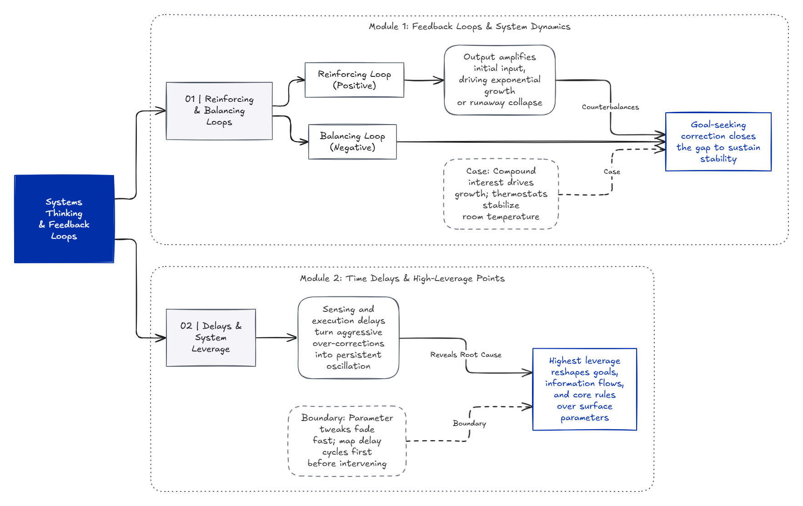
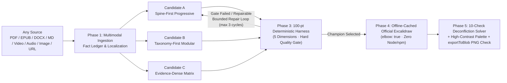

# Cartograph

**Autonomous Instructional Knowledge Graph & Official Excalidraw Synthesis Engine**

[](#visual-design-system--spatial-grammar)
[](#10-check-real-excalidraw-zero-interference-engine)
[](#deterministic-evaluation-harness)
[](#offline-cached-official-excalidraw-engine--visual-self-check)
[](#installation)
[](#license)

> Turn any book, paper, course, video, audio recording, image, or web page into a **fact-audited, zero-interference, publication-grade Mermaid Flowchart (`.mmd`) and native editable Excalidraw (`.excalidraw`) canvas** — powered by **Multi-Candidate Tournament Synthesis**, a **100-Point Deterministic Harness**, an **Offline-Cached Official Excalidraw Engine (`elbow: true`)**, and a **10-Check Real-Excalidraw Geometric Deconfliction Solver**.


*Real unedited output rendered by Cartograph's own pipeline (`examples/showcase-en.mmd` → official `@excalidraw/mermaid-to-excalidraw` with `elbow: true` → 10-check `excalidraw_deconflict.py` → `exportToBlob` PNG): Klein Blue `#002FA7` focus anchors, dark-gray `#4B5563` solid content cards and rounded dense-dotted module containers, `#6B7280` dashed auxiliary evidence cards, authentic Excalifont hand-drawn strokes, and 100% orthogonal arrows with zero overlaps.*

---

## The Problem Cartograph Solves

Anyone who has tried turning a dense 300–500 page book, lecture series, or technical spec into a readable visual knowledge map hits five recurring walls:

1. **Page-by-page AI summarizers shatter narrative logic**: Mechanical page-boundary chunking produces shallow bullet lists that lose causal structure and feel worse to read than the original text.
2. **Single-shot LLM Mermaid prompts produce unreadable hairballs**: They hallucinate loose cross-chapter spaghetti links, drop formulas/edge cases, silently break Mermaid syntax, or split one cohesive work into disconnected canvases.
3. **Raw `mermaid-to-excalidraw` breaks on real dense & multilingual graphs**: Even when the Mermaid syntax is valid, raw Excalidraw conversion routinely outputs curved diagonal splines (when `elbow: true` is omitted), places elbow turns **18px from a target box wall** so edge labels collide straight into node rectangles, stacks parallel arrows on top of each other's labels, clips Excalifont chapter titles, lets external trunk lines run across module borders, and overflows module frames past their right-most cards. *(Even on the compact 11-node English showcase above, raw official export produces **17 geometric & clipping defects** — all 4 edge labels collide into target nodes, 11 cards overflow Excalifont bounds, and both module titles clip; Cartograph's solver eliminates all 17 deterministically.)*
4. **No deterministic verification loop**: Existing diagram skills generate once and pray — never measuring node overlap, label collisions, text clipping, or cross-module noise, and never inspecting rendered pixels before delivery.
5. **Heavy runtime friction**: Most Mermaid-to-Excalidraw pipelines force you to install Node.js, npm, Puppeteer/Playwright, and live CDN bundles just to export one `.excalidraw` file.

---

## What Makes Cartograph Fundamentally Different

| Dimension | Raw `@excalidraw/mermaid-to-excalidraw` | Single-Shot LLM Prompt | Page-by-Page Book Reader | **Cartograph** |
|---|:---:|:---:|:---:|:---:|
| Universal multimodal ingestion (PDF/EPUB/DOCX/Media/URL) | — | Partial | Text/PDF only | **Full + Fact-Boundary Protocol** |
| Single-canvas semantic skeleton (zero artificial splitting) | — | Unreliable | — | **Enforced (`ROOT → Vertical MODs`)** |
| Local evidence preservation + cross-module noise filtering | — | Hairball links | — | **Deterministic Budget & Rules** |
| Multi-candidate architecture tournament (3 parallel agents) | — | — | — | **Code-Enforced (`orchestrate_pipeline.py`)** |
| 100-pt deterministic harness + bounded self-healing loop | — | — | — | **Built-in (`max=3`, rollback + stall guard)** |
| Official `elbow: true` Excalidraw engine (100% orthogonal) | Manual web UI | — | — | **Automated + Offline Disk Cache (Zero Node/npm)** |
| Post-export **10-Check Zero-Interference Solver** (labels, X-crossings, CJK clip, module frames, trunks) | — | — | — | **Built-in (`excalidraw_deconflict.py`)** |
| Photographic `exportToBlob` visual self-inspection | — | — | — | **Built-in (`--render-dir`)** |
| Regression test suite (`--self-test`) | Library unit tests | — | Unit tests | **16-Test End-to-End Suite** |

---

## Visual Design System & Spatial Grammar

Cartograph ships with a carefully calibrated, high-contrast **editorial whiteboard aesthetic** designed for sustained deep reading — every color token, border stroke, and spatial relationship carries semantic meaning:

| Visual Element | Role in Knowledge Graph | Exact Styling Specification |
|---|---|---|
| **Root Anchor (`ROOT`)** | Single global thesis / book title centered on the far left | **Klein Blue `#002FA7`** solid fill, `#002FA7` border (`2px`), crisp `#FFFFFF` bold text (`32px`) |
| **Key Conclusions (`KEY`)** | Core takeaways, laws, iron rules, and high-leverage insights | Pure `#FFFFFF` fill, **Klein Blue `#002FA7`** border (`2px`), `#002FA7` bold text (`20px`) |
| **Module Headers (`MOD_*`)** | Top-level chapters/sections stacked strictly top-to-bottom on the right of `ROOT` | Soft gray `#F5F5F7` fill, **dark gray `#4B5563`** solid border (`1.5px`), `#1D1D1F` bold text (`26px`) |
| **Primary Content Cards (`SUB_*`, `K*`)** | Sub-sections, mechanisms, concepts, and sequential steps | Pure `#FFFFFF` fill, **dark gray `#4B5563`** solid border (`1.5px`), `#1D1D1F`/`#3A3A3C` text (`20px`) |
| **Auxiliary Evidence Cards (`note`)** | Formulas, data points, concrete cases, counterexamples, and boundary warnings | Pure `#FFFFFF` fill, **one-shade-lighter `#6B7280`** **normal dashed border** (`strokeStyle: "dashed"`, `1.5px`), `#3A3A3C` text |
| **Module Outer Containers (`subgraph`)** | Visual boundary grouping each top-level module and its internal logic | Pure `#FFFFFF` fill, **dark gray `#4B5563`** **dense dotted border** (`strokeStyle: "dotted"`, `1.5px`), **rounded corners** (`roundness: {"type": 3}`), `34–38px` interior padding |
| **Connectors & Typography** | Causal chains, structure links, and local evidence links | **100% orthogonal elbow arrows** (`elbowed: true`), authentic Excalidraw hand-drawn strokes (`roughness: 1`), **Excalifont (`fontFamily: 5`)**, crisp `16px` centered edge labels |

### Spatial Grammar Rules
- **Top-to-Bottom Secondary Modules**: `ROOT` connects directly to all `MOD_*` via a dedicated vertical trunk highway (`≥ 32px` left of all module borders, `20px` lane spacing, zero trunk crossings). Modules stack cleanly top-to-bottom — never chained into an unreadable left-to-right horizontal train.
- **Horizontal Strong Logic, Vertical Independent Branches**: Inside each module, direct causal/progressive chains expand horizontally left-to-right with precise verb labels; parallel independent concepts stack vertically.
- **Evidence Attached Locally, Cross-Module Noise Filtered**: Formulas, cases, counterexamples, and data attach directly beside the claim they support via labeled dashed arrows (`Case`, `Evidence`, `Formula`, `Boundary`, `Counterexample`). Loose cross-module thematic echoes are intentionally filtered and documented in the companion guide so the canvas stays spacious.

---

## Architecture Pipeline



---

## Deep Dive: Engineering Pillars

### 1. Universal Multimodal Ingestion & Bilingual Language Modes (`--lang en` / `--lang zh`)
| Input Format | Ingestion Mechanism | Integrity Guarantee |
|---|---|---|
| **PDF, Images, Audio, Video** | Native multimodal agent reading | Preserves diagrams, equations, tables, slides, and spoken nuance |
| **EPUB, DOCX, HTML, SRT/VTT, MD, TXT** | `scripts/extract_content.py` (Python stdlib only) | Spine-ordered EPUB extraction, DRM detection, heading preservation, subtitle timestamp cleanup |
| **Static & Dynamic Web URLs** | `extract_content.py` / Browser subagent | Strict factual boundary: paywalled or unreachable sources trigger an explicit gap report — never fabricated |

- **Dual Language Modes (`--lang en` & `--lang zh`)**: Generate pure English graphs with `--lang en` (as shown in the hero showcase above), or automatically localize foreign-language books, papers, and courses into idiomatic Simplified Chinese (`--lang zh`, the default for Chinese prompts) while preserving key acronyms, formulas, and framework names in concise bilingual parentheticals — deterministically verified by the harness (`cjk_node_ratio >= 0.85` in `zh` mode).

### 2. Code-Enforced Parallel 3-Candidate Tournament & Bounded Self-Healing Loop
`scripts/orchestrate_pipeline.py` enforces multi-candidate synthesis in executable workflow code (not wishful prompt text):
- Spawns **3 competing architectural agents concurrently** (`spine-first`, `taxonomy-first`, `evidence-dense`).
- Grades all 3 candidates head-to-head through `scripts/eval_harness.py` and promotes the highest-scoring compliant champion.
- If the champion misses the hard quality gate (`score >= 88`, zero hard errors, zero overlaps, zero arrow collisions), enters a **bounded self-healing repair loop** (`max 3 cycles`) feeding exact harness diagnostics back into targeted repairs — with automatic rollback on regression and stall detection (`delta < 1.0`).

### 3. Deterministic Evaluation Harness (100-Point Rubric + 16-Test Suite)
| Dimension | Weight | Automated Checks |
|---|---:|---|
| **Spec & Localization Compliance** | 30 | `flowchart LR`, unique non-reserved IDs, zero subgraph-endpoint edges, zero placeholder meta-terms, full `class` coverage, edge budget `≤ 500`, and localization ratio (`cjk_node_ratio >= 0.85` in `zh` mode) |
| **Structural & Relation Discipline** | 25 | `ROOT → all MOD`, explicit strong-logic chains, labeled auxiliary dashed lines, penalty on vague labels, cross-module ratio control |
| **Geometric Layout & Routing Clarity** | 20 | Exact AABB node overlap (`== 0`), subgraph overlap (`== 0`), container containment, Liang-Barsky arrow-through-node collision (`== 0`), exact crossing count, aspect ratio |
| **Readability & Typography Density** | 15 | Node line count `≤ 6`, CJK-weighted line width `≤ 28` units, clean `<br/>` breaks, zero empty nodes |
| **Evidence & Auxiliary Fidelity** | 10 | Local dashed evidence attachment and `key` visual differentiation |

### 4. Offline-Cached Official Excalidraw Engine & Visual Self-Check
`scripts/official_excalidraw_export.py` (cross-platform Python stdlib) and `scripts/official_excalidraw_export.ps1` (zero-Python Windows PowerShell) run Excalidraw's **exact official conversion packages** inside your locally installed Chrome or Edge — with **zero Node.js, zero npm, and zero Playwright installs**:
- Executes `@excalidraw/mermaid-to-excalidraw@3.6.0` (`elbow: true`) + `@excalidraw/excalidraw@0.18.1` (`convertToExcalidrawElements` + `exportToBlob`).
- **Persistent Local `/npm/*` Disk Cache (`resources/cdn_cache/`)**: Automatically caches all ESM bundles and Excalifont assets on first run; every subsequent run executes **100% offline** in seconds (`hits=125+, misses=0`).
- **Photographic Visual Self-Inspection (`--render-dir` / `-RenderDir`)**: Uses Excalidraw's own `exportToBlob` canvas renderer (bypassing headless browser screenshot quirks) to export real high-resolution PNG close-up tiles of post-deconflict canvases for pixel-level verification before delivery.

### 5. 10-Check Real-Excalidraw Zero-Interference Engine
Official Excalidraw conversion leaves real geometric defects on dense CJK graphs. `scripts/excalidraw_deconflict.py` audits and deterministically repairs the actual exported `.excalidraw` JSON using Excalidraw's exact bound-label midpoint rule (verified 100% exact across hundreds of official arrows):

| # | Invariant Enforced (`== 0`) | Automated Geometric Fix |
|---:|---|---|
| 1 | `label_vs_node_overlaps` | Recenters wall-hugging elbow bends into open channel midpoints; minimally widens corridors only when a label exceeds the gap |
| 2 | `label_vs_label_overlaps` | Separates competing adjacent labels into distinct lanes or subtle vertical offsets |
| 3 | `label_vs_other_arrow_collisions` | **Pairwise X-crossing lane-swap solver** swaps conflicting vertical bends (left/right lane ordering) so orthogonal crossings occur on empty segments — never across text |
| 4 | `coincident_vertical_tracks` | Assigns parallel arrows overlapping in Y-range to distinct spaced vertical lanes (`≥ 16px` separation) |
| 5 | `node_text_overflows` | Calibrated for actual **Excalifont** CJK (`1.12×`) and hand-drawn digit (`0.78×`) glyph metrics; expands boxes per column once (zero cumulative width bloat) |
| 6 | `title_text_overflows` | Widens both subgraph title `text.width` and transparent title-band containers so chapter titles never clip at left/right edges |
| 7 | `node_vs_node_overlaps` | Resolves tight box collisions cleanly while preserving subgraph structure |
| 8 | `arrow_vs_node_collisions` | Routes exterior/interior elbow segments cleanly clear of any non-endpoint box |
| 9 | `subgraph_containment_violations` + `subgraph_overlaps` | Refits every rounded dotted module container around 100% of its member nodes, internal arrows, labels, and title band (`34–38px` padding, `≥ 48px` inter-module gap) |
| 10 | `trunk_vs_subgraph_collisions` + `orthogonal_ratio == 1.0` | Allocates a dedicated vertical trunk highway strictly left of all module frames (`≥ 32px` clearance, `20px` lane spacing) while keeping 100% of arrow segments horizontal/vertical |

---

## Installation

Install Cartograph as a global Agent Skill in your agent's skill directory:

```bash
# Antigravity / Gemini
git clone https://github.com/aidenlychen-debug/cartograph.git ~/.gemini/config/skills/knowledge-graph-architect

# Cross-agent standard path (Claude Code / Codex / Open Agent Skills)
git clone https://github.com/aidenlychen-debug/cartograph.git ~/.agents/skills/knowledge-graph-architect
```

### Directory Layout

```text
knowledge-graph-architect/
├── SKILL.md                                  # Agent runbook & 5-Phase Execution Contracts
├── README.md                                 # Project documentation (this file)
├── LICENSE                                   # Personal Free / Commercial Authorization license
├── .gitignore                                # Excludes local runtime cache & temp files
├── resources/
│   └── official_converter.html               # Official @excalidraw ESM & exportToBlob bridge
├── references/
│   ├── architecture-spec.md                  # Full visual, logical & Mermaid engineering spec
│   ├── loop-and-tournament-protocol.md       # Harness rubric, repair loop & tournament policy
│   └── ingestion-guide.md                    # Multimodal ingestion & fact-boundary handbook
├── scripts/
│   ├── extract_content.py                    # Zero-dep EPUB/DOCX/HTML/SRT/VTT/URL extractor
│   ├── official_excalidraw_export.py         # Primary exporter: offline-cached official engine + deconflict + PNG proofs
│   ├── official_excalidraw_export.ps1        # Zero-Python Windows PowerShell official exporter & PNG verifier
│   ├── excalidraw_deconflict.py              # 10-check real-Excalidraw zero-interference & palette engine
│   ├── eval_harness.py                       # 100-pt deterministic harness, tournament selector & 16-test suite
│   ├── orchestrate_pipeline.py               # Code-enforced parallel 3-candidate tournament + repair loop
│   └── mermaid_to_excalidraw.py              # Static Mermaid auditor, geometry checker & offline fallback compiler
└── examples/
    ├── showcase-en.mmd                       # English showcase Mermaid source rendered in README
    ├── preview-showcase.png                  # Real rendered Excalidraw showcase from showcase-en.mmd
    └── golden-reference.mmd                  # CJK localization regression fixture for --self-test
```

---

## Quick Start

### 1. Run the 16-Test Regression Suite
```bash
python scripts/eval_harness.py --self-test
```
Expected output: `all_passed: true` (`16/16` tests passing, covering Mermaid spec rules, Chinese localization gates, obstacle-avoiding routing, wall-hugging label recentering, X-crossing lane swaps, title clipping, module containment, trunk clearance, and palette enforcement).

### 2. Extract Structured Text from EPUB / DOCX / Subtitles / URL
```bash
python scripts/extract_content.py path/to/source.epub -o extracted.txt
```

### 3. Run Multi-Candidate Tournament, Official Export, 10-Check Deconflict & PNG Verification
```bash
# Select optimal Mermaid candidate through 100-pt deterministic harness
python scripts/eval_harness.py \
  --tournament candidate_a.mmd candidate_b.mmd candidate_c.mmd \
  --out-mmd output_graph.mmd

# Export via official Excalidraw (elbow:true) + auto 10-check deconflict + render PNG visual proof
python scripts/official_excalidraw_export.py output_graph.mmd \
  -o output_graph.excalidraw \
  --render-dir ./visual_proofs
```

*(On Windows without Python on PATH, use `scripts/official_excalidraw_export.ps1` with local Chrome or Edge.)*

### 4. Open Your Canvas
Drag and drop `output_graph.excalidraw` directly onto [excalidraw.com](https://excalidraw.com) or into the **Obsidian Excalidraw** plugin.

---

## Honest Four-State Verification Ledger

Cartograph enforces strict reporting honesty in every deliverable by separating four independent verification stages (unexecuted stages are explicitly marked `Not Executed`):
1. **Static Spec Audit** — Mermaid syntax, unique IDs, relation rules, edge budget, localization ratio (`eval_harness.py`)
2. **Official Excalidraw Compilation** — `@excalidraw/mermaid-to-excalidraw@3.6.0` (`elbow: true`) + `@excalidraw/excalidraw@0.18.1`
3. **10-Check Real-Excalidraw Geometric Gate** — zero label/node/arrow/track/title/module/trunk interference (`excalidraw_deconflict.py`)
4. **Photographic Visual Inspection** — real `exportToBlob` high-res PNG tiles inspected directly before delivery

---

## License

**Free for Personal & Non-Commercial Trial; Commercial Use Requires Prior Written Authorization.**

- **Personal & Non-Commercial Use (Free)**: Individuals may freely download, install, run, study, and evaluate Cartograph for personal learning, research, and non-commercial purposes, provided the copyright and license notice is retained.
- **Commercial Use (Authorization Required)**: Any commercial use — including integration into commercial software/SaaS/paid plugins, paid consulting/courses/content production, internal deployment by for-profit organizations or teams, or commercial redistribution — requires **prior written authorization** from the author. Please open an issue in [GitHub Issues](https://github.com/aidenlychen-debug/cartograph/issues) for commercial licensing inquiries. See [LICENSE](./LICENSE) for full terms.
